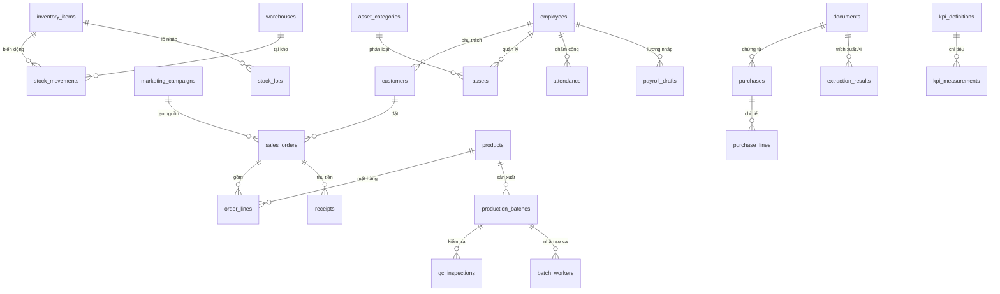

# SUNNY AI V86 — Mô tả cấu trúc Database và quan hệ

## 1. Nguyên tắc
- `database/schema_target.sql` là **lược đồ đích**; `backend/db.py` tự tạo bảng khi khởi động.
- SQLite dùng cho chạy thử/một máy; trước khi vận hành nhiều người đồng thời cần cân nhắc PostgreSQL, migration, backup/restore và giám sát.
- Tất cả bản ghi nghiệp vụ dùng UUID, mã nghiệp vụ có ràng buộc `UNIQUE`, khóa ngoại bật (`PRAGMA foreign_keys=ON`).
- `source_kind`: `real`, `sample`, `imported` giúp tránh lẫn dữ liệu mô phỏng với dữ liệu thật.
- Phân quyền phải kiểm tra trên máy chủ và đến phạm vi từng bản ghi, không dựa vào ẩn menu.

## 2. Sơ đồ quan hệ chính


## 3. Những liên thông bắt buộc
1. **Marketing → khách hàng → đơn hàng → tiền thu**: `marketing_campaigns.id` → `sales_orders.campaign_id` → `receipts.order_id`. Không gán doanh thu cho chiến dịch nếu không có nguồn.
2. **Mua hàng → chứng từ → kho/tài sản/chi phí**: `documents.id` → `purchases.document_id`; phân loại theo `purchases.classification`. Không cộng nguyên giá mua máy vào chi phí tháng nếu phải khấu hao.
3. **Kho → sản xuất → QC**: `stock_movements.batch_id` → `production_batches.id` → `qc_inspections.batch_id`; cần bổ sung nghiệp vụ phân bổ vật tư theo lô.
4. **Thiết bị điện → ca sản xuất → chi phí/m²**: `meter_readings` → `energy_allocations.batch_id` → sản lượng QC đạt. Phải có đồng hồ và quy tắc phân bổ thực.
5. **Nhân sự → công việc → KPI → lương nháp**: `employees`, `duty_assignments`, `kpi_measurements`, `payroll_drafts`; chỉ số chưa xác minh không tự thành lương chính thức.
6. **12 nhóm chi phí → giảm 3%**: `cost_transactions` làm sổ chi phí đã phân loại, `cost_opportunities` lưu đề xuất và `approvals` ghi duyệt. Tổng hợp không được nhân đôi cùng chứng từ.
7. **AI**: `documents`/`extraction_results`, `agent_runs`, `alerts`, `approvals`, `audit_log`. AI được đọc có kiểm soát, ghi nháp, không tự duyệt tiền/lương/kỷ luật.

## 4. Các bảng trọng yếu
| Nhóm | Bảng | Khóa và ý nghĩa |
|---|---|---|
| Nhân sự | `employees`, `employee_private`, `attendance`, `payroll_drafts` | `employee_id`, dữ liệu riêng tư cần mã hóa và phân quyền chặt |
| CRM | `customers`, `customer_interactions`, `sales_orders`, `order_lines`, `receipts` | `customer_id`, `order_id`; đơn hàng và thu tiền là hai nghiệp vụ khác nhau |
| Marketing | `marketing_campaigns`, `marketing_leads` | `campaign_id` để đo chi phí tạo đơn và tiền thu |
| Kho | `inventory_items`, `warehouses`, `stock_lots`, `stock_movements` | tồn kho = SUM(`quantity_delta`) theo SKU và kho |
| Tài sản | `asset_categories`, `assets`, `asset_events` | nguyên giá, giá trị còn lại, người giữ, bàn giao |
| Mua hàng | `purchases`, `purchase_lines`, `documents` | `request_id` duy nhất, kiểm tra hóa đơn trùng |
| Sản xuất | `production_batches`, `batch_workers`, `qc_inspections` | 1 tổ trưởng kiêm KCS + 5 công nhân/ca là quy tắc nghiệp vụ cần kiểm tra |
| Điện | `meters`, `meter_readings`, `energy_allocations` | số công tơ và phân bổ theo lô |
| KPI | `kpi_definitions`, `kpi_measurements` | kỳ ngày/tuần/tháng/quý/năm, nguồn và trạng thái xác minh |
| Tài chính | `cost_transactions`, `cost_opportunities` | phân rã chi phí, khoản tiết kiệm ước tính và đã xác minh |
| Hệ thống | `audit_log`, `sync_inbox`, `api_idempotency` | lịch sử, đồng bộ, chống ghi trùng |

## 5. Truy vấn SQL mẫu
**Tồn kho và cảnh báo 40%:**
```sql
SELECT i.sku,i.name,i.standard_qty,
       COALESCE(SUM(m.quantity_delta),0) AS stock,
       CASE WHEN i.standard_qty>0 AND COALESCE(SUM(m.quantity_delta),0)<=i.standard_qty*0.4 THEN 1 ELSE 0 END AS warning
FROM inventory_items i
LEFT JOIN stock_movements m ON m.item_id=i.id
GROUP BY i.id;
```
**Doanh số và tiền thu theo chiến dịch:**
```sql
WITH order_values AS (
 SELECT o.id,o.campaign_id,COALESCE(SUM(l.quantity*l.unit_price-l.discount),0) AS revenue
 FROM sales_orders o LEFT JOIN order_lines l ON l.order_id=o.id GROUP BY o.id
), receipts_by_order AS (
 SELECT order_id,SUM(amount) AS received FROM receipts WHERE verified=1 GROUP BY order_id
)
SELECT m.name,COALESCE(SUM(v.revenue),0) AS revenue,
       COALESCE(SUM(r.received),0) AS collected
FROM marketing_campaigns m LEFT JOIN order_values v ON v.campaign_id=m.id
LEFT JOIN receipts_by_order r ON r.order_id=v.id
GROUP BY m.id;
```
**Chi phí quản trị theo tháng:**
```sql
SELECT period,category,SUM(amount) AS total
FROM cost_transactions WHERE source_kind='real'
GROUP BY period,category ORDER BY period,category;
```

## 6. Khoảng trống triển khai
Schema bao quát hơn các endpoint đã triển khai. Cần thêm API có giao dịch cho: dòng đơn hàng, thu tiền, điều chuyển tài sản, lô QC, chấm công, bảng lương nháp, phê duyệt, phân bổ khấu hao/chi phí trả trước, xử lý ảnh OCR thật và đồng bộ V86 localStorage. Không đưa vào vận hành chính thức khi chưa hoàn tất kiểm thử phân quyền và đối soát.
